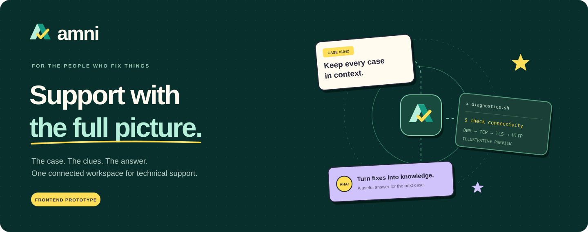

<div align="center">


# AMNI

### Technical support, with the full picture

A connected workspace for support cases, infrastructure troubleshooting, and team knowledge.

[](#project-status)
[](#deployment)
[](#technology-stack)

[Overview](#what-amni-does) · [Technology stack](#technology-stack) · [Quick start](#quick-start) · [Deployment](#deployment) · [Roadmap](#roadmap)

</div>



## What AMNI does

AMNI brings the support request, the investigation, and the useful answer into
one place. It is designed for teams working with applications, Linux servers,
Docker containers, and networks.

<table>
<tr>
<th align="left">01 · Manage the case</th>
<th align="left">02 · Investigate the issue</th>
<th align="left">03 · Share the answer</th>
</tr>
<tr>
<td>Keep the issue, priority, status, and ownership together. Follow the case from first report to resolution.</td>
<td>Use diagnostic context to investigate DNS, connectivity, ports, TLS, HTTP, and container problems.</td>
<td>Find a troubleshooting guide before opening another case, and keep reusable answers close to the team.</td>
</tr>
</table>

The current release is an **interactive frontend prototype**. Real diagnostic
execution, shared case data, and server-side security controls are planned.

## Technology stack

### Implemented frontend

<p>


</p>

| Technology | Role in AMNI |
| --- | --- |
| **Next.js + React** | Application pages, reusable components, and interactive workflows. |
| **TypeScript** | Typed case models, interface state, and component contracts. |
| **Tailwind CSS + custom CSS** | Responsive presentation and AMNI's visual system. |
| **Lucide + Manrope** | Interface icons and self-hosted typography. |
| **Browser localStorage** | Persistence for demo cases on the current browser and origin. |

### Planned backend and delivery stack

<p>


</p>

FastAPI and PostgreSQL will provide persistent case management. Authenticated
WebSockets will deliver case updates. Role-based authorization and audit logging
are planned alongside controlled diagnostic workers. Docker Compose, Nginx,
HTTPS, GitHub Actions, and a cost-conscious AWS deployment complete the intended
architecture.

These services are **not implemented or deployed yet**. The Python project and
infrastructure directories currently contain scaffolding.

## Project status

| Capability | Status |
| --- | --- |
| Responsive homepage and original AMNI branding | **Implemented** |
| Demo case creation, search, filters, details, and status changes | **Implemented** |
| Browser persistence for demo cases | **Implemented** |
| Knowledge-base topic filters and sample guides | **Implemented** |
| DNS, TCP, TLS, and HTTP diagnostic preview | **Simulated output** |
| FastAPI, PostgreSQL, and authenticated WebSockets | **Planned** |
| Authentication, authorization, and audit logging | **Planned** |
| Real diagnostic workers, Docker services, and cloud deployment | **Planned** |

[View desktop preview](amni/docs/previews/desktop.png) · [View mobile preview](amni/docs/previews/mobile.png)

## Quick start

Requires **Node.js 20.9+** and npm. From the repository root:

```bash
cd amni/frontend
npm ci
npm run dev
```

Open **[http://localhost:3000](http://localhost:3000)**.

No database, Docker installation, environment variables, or AWS credentials are
needed for this frontend preview. If Next.js reports an existing development
server, use its printed URL or stop it with **Ctrl+C** before starting another.

### Check and build

From `amni/frontend/`:

```bash
npm run typecheck
npm run build
```

The production build uses Webpack and exports the site to `amni/frontend/out/`.
To preview that export with Python:

```bash
python3 -m http.server 8080 --directory out
```

Open **[http://localhost:8080](http://localhost:8080)**. The static export has no
`npm start` script; any suitable static file server can serve `out/`.

## Deployment

<!-- Replace the #deployment link above with the verified live URL after the first deployment. -->

| Environment | Link / status |
| --- | --- |
| **Live application** | **Coming soon** — the deployment URL will be added here after hosting is configured. |
| **Local development** | [localhost:3000](http://localhost:3000) |
| **Local production preview** | [localhost:8080](http://localhost:8080) after building and serving `out/`. |

No public deployment is currently verified. The intended full platform uses
Docker Compose and Nginx with HTTPS. AWS services will be introduced as the
backend and operational requirements develop.

## Repository structure

```text
Amni/
├── README.md
└── amni/
    ├── frontend/                 # Working Next.js prototype
    │   ├── app/
    │   ├── components/
    │   ├── lib/
    │   └── public/
    ├── backend/                  # Planned FastAPI application
    │   ├── app/
    │   ├── tests/
    │   └── pyproject.toml
    ├── nginx/                    # Reverse-proxy configuration placeholder
    ├── docs/                     # Architecture, design, assets, and previews
    ├── .github/workflows/        # CI/CD placeholder
    ├── docker-compose.yml        # Development placeholder
    └── docker-compose.prod.yml   # Production placeholder
```

The Compose files contain empty service maps; they do not start the application.

## Demo data

The current interface uses sample cases and guides from
[`amni/frontend/lib/demo.ts`](amni/frontend/lib/demo.ts). Case changes stay in the
current browser under the localStorage key `amni-demo-cases`, when storage is
available. They are not sent to a backend or shared with other users.

To restore the initial sample cases, run this in the browser console while AMNI
is open. It removes saved demo cases for that origin:

```js
localStorage.removeItem('amni-demo-cases');
location.reload();
```

## Roadmap

- [x] Build the frontend, custom AMNI identity, and responsive interface.
- [x] Add interactive case workflows, sample guides, and diagnostic previews.
- [ ] Implement FastAPI, PostgreSQL models, migrations, and case APIs.
- [ ] Add authentication, role-based authorization, and audit records.
- [ ] Deliver case updates through authenticated WebSockets.
- [ ] Add knowledge-base search and restricted Linux/network diagnostics.
- [ ] Configure Docker, Nginx, HTTPS, automated tests, CI/CD, and AWS hosting.

## Documentation

- [Frontend setup and source guide](amni/frontend/README.md)
- [Planned architecture](amni/docs/architecture.md)
- [Design direction and verification](amni/docs/design.md)
- [Initial history and reconstruction note](amni/docs/history-reconstruction.md)

The frontend build, TypeScript checks, and interactive browser checks have passed.
Responsive verification covered **375, 390, 768, 1024, and 1440 pixel widths**.
Backend and integration tests are pending implementation.

## License

A project-wide software license has not been added. The bundled Manrope font
includes its [SIL Open Font License](amni/frontend/public/fonts/Manrope-LICENSE.txt).

---

<div align="center">
<strong>AMNI</strong> · For humans, and the systems they look after.<br>
<a href="https://github.com/Aishagojo/Amni">Repository</a> ·
<a href="https://github.com/Aishagojo/Amni/issues">Issues</a>
</div>
