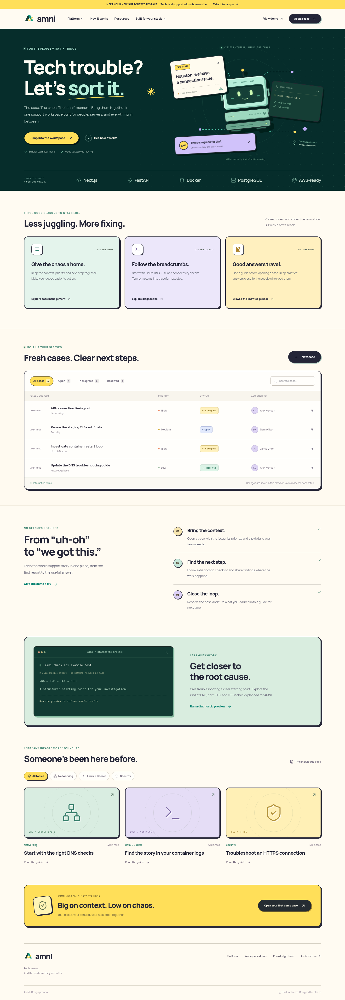
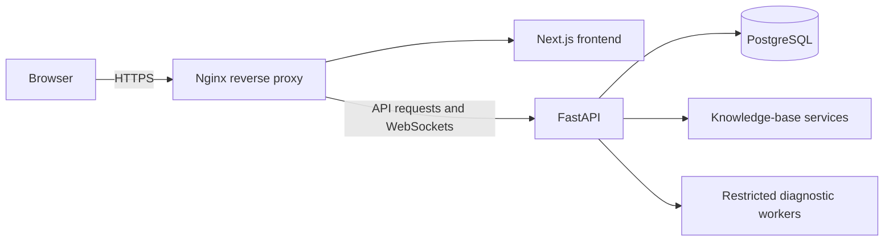

<p>
  
</p>

# AMNI

**Technical support, with the full context.**

AMNI is a support platform for the people who troubleshoot applications, Linux
servers, containers, and networks. Its goal is to bring cases, diagnostic findings,
and reusable knowledge into one workspace.

> **Project status:** the interactive frontend prototype is implemented. The
> backend is a directory scaffold; FastAPI, PostgreSQL, authentication, WebSockets,
> and deployment services are not running yet.

[Quick start](#quick-start) · [What works today](#what-works-today) ·
[Architecture](#architecture) · [Roadmap](#roadmap) · [Documentation](#documentation)

## Preview

The interface pairs a dark teal hero with cream surfaces, mint and lavender
accents, and yellow action buttons. A custom AMNI mark and an original support
illustration give the project its visual identity.

[View desktop preview](docs/previews/desktop.png) ·
[View mobile preview](docs/previews/mobile.png)

<details>
<summary>Open the desktop screenshot</summary>



</details>

## What works today

| Area | Current behavior |
| --- | --- |
| Homepage | Responsive layout, custom branding, illustrated hero, and mobile navigation. |
| Case queue | Search, status filters, case details, and priority labels. |
| Case workflow | Create demo cases, start investigations, resolve cases, and reopen them. |
| Demo persistence | Cases are saved in browser localStorage when available. |
| Knowledge base | Filter sample guides by topic and open their troubleshooting content. |
| Diagnostics | Run a preview that displays illustrative DNS, TCP, TLS, and HTTP results. |
| Architecture overview | Read the intended technology stack in a dialog. |

**The backend does not work yet.** There is no FastAPI application entry point,
API route, database connection, or WebSocket endpoint. The backend project file
currently declares no dependencies.

The frontend uses sample data and browser state. Diagnostic output is simulated;
it does not contact hosts or execute shell commands. Case changes are not sent to
a support team or shared between users.

## Quick start

### Requirements

- Node.js **20.9 or newer** and npm.
- No database, Docker installation, AWS account, or environment variables are
  required to run the current frontend.

### Start the development server

From the directory containing `amni/`:

```sh
cd amni/frontend
npm ci
npm run dev
```

Open **[http://localhost:3000](http://localhost:3000)**. If you are already inside
`amni/`, use `cd frontend` instead. `npm ci` installs the versions recorded in
`package-lock.json`.

### Check and build

Run these commands from `amni/frontend/`:

```sh
npm run typecheck
npm run build
```

| Command | Purpose |
| --- | --- |
| `npm run dev` | Start the Next.js development server with hot reload. |
| `npm run typecheck` | Check TypeScript types without emitting application files. |
| `npm run build` | Create a production static export using Next.js and Webpack. |

The production output is written to **`frontend/out/`**. The project uses
`output: 'export'`; it has no `npm start` script.

To inspect the production export locally, use Python's static HTTP server from
`amni/frontend/`:

```sh
python3 -m http.server 8080 --directory out
```

Open **[http://localhost:8080](http://localhost:8080)**. Python is only needed for
this optional preview command; any suitable static file server can serve `out/`.

## Demo data and troubleshooting

### Case storage

The initial cases and guides live in [`frontend/lib/demo.ts`](frontend/lib/demo.ts).
Case changes are saved under the localStorage key `amni-demo-cases`. Storage is
specific to the browser and origin, so another browser or a different port has a
separate demo workspace. When storage is unavailable, changes last for the current
page session.

To restore the sample cases, run the following in the browser console while AMNI
is open. This removes the demo cases saved for that origin:

```js
localStorage.removeItem('amni-demo-cases');
location.reload();
```

### “Another next dev server is already running”

Open the URL printed for the existing server, usually `http://localhost:3000`.
Starting on another port does not allow two Next.js development servers in the
same project directory.

If the server was paused with **Ctrl+Z**, resume it with `fg` in its original
terminal. Use **Ctrl+C** to stop it before starting a new instance.

To choose a different port after stopping the existing instance:

```sh
npm run dev -- --port 3001
```

### Docker Compose starts no services

Both Compose files currently contain `services: {}`. Dockerfiles, container
services, Nginx configuration, and HTTPS setup are still planned. Use the frontend
commands above for the current implementation.

## Technology stack

| Layer | Technology | Status |
| --- | --- | --- |
| Frontend | Next.js, React, TypeScript, Tailwind CSS | Implemented |
| Icons and typography | Lucide icons, self-hosted Manrope | Implemented |
| API | Python 3.11+, FastAPI | Planned; Python project metadata only |
| Database | PostgreSQL | Planned |
| Real-time updates | Authenticated WebSockets | Planned |
| Access control | Role-based authorization and audit logging | Planned |
| Diagnostics | Linux, Docker, DNS, HTTP/HTTPS, TCP, ports, and TLS | Sample output only |
| Deployment | Docker Compose, Nginx, HTTPS | Planned |
| CI/CD | GitHub Actions | Planned |
| Cloud | AWS, with services introduced as needed | Planned |

## Architecture

The current runtime is a Next.js frontend with sample data and browser storage.
The following diagram describes the **planned full platform**:



The intended backend will manage cases and users, authorize case access, publish
case updates, and record audit events. Diagnostic workers will handle approved
checks with target validation, execution limits, and controlled network access.

The AWS deployment plan starts small and keeps service choices deliberate. EC2
is the initial hosting path; RDS, CloudWatch, S3, Secrets Manager, and ECS are
options as operational requirements grow. No AWS resources have been provisioned.

See the [architecture document](docs/architecture.md) for more detail.

## Project structure

```text
amni/
├── frontend/
│   ├── app/                  # Pages, layout, styles, and application icon
│   ├── components/           # AMNI branding and support illustration
│   ├── lib/                  # Demo data and shared types
│   ├── public/fonts/         # Self-hosted font and its license
│   └── package.json
├── backend/
│   ├── app/
│   │   ├── api/              # Planned HTTP and WebSocket endpoints
│   │   ├── core/             # Planned settings, authentication, authorization
│   │   ├── models/           # Planned persistence models
│   │   ├── schemas/          # Planned request and response schemas
│   │   └── services/         # Planned case, knowledge, and diagnostic services
│   ├── tests/                # Reserved for backend tests
│   └── pyproject.toml
├── nginx/                    # Reserved for reverse-proxy configuration
├── docs/                     # Architecture, design notes, and previews
├── .github/workflows/        # Reserved for CI/CD workflows
├── docker-compose.yml        # Development placeholder
├── docker-compose.prod.yml   # Production placeholder
├── .env.example              # Environment-variable documentation placeholder
├── .gitignore
└── README.md
```

Empty scaffold directories contain `.gitkeep` files. The existing `docfo` file is
also preserved.

## Verification

The frontend production export and TypeScript checks have passed. Browser checks
covered widths of **375, 390, 768, 1024, and 1440 pixels**, with no horizontal
overflow or browser runtime errors observed.

The verified flows include case creation and persistence, search, status filters
and transitions, guide dialogs, topic filters, the diagnostic preview, the
architecture dialog, and mobile navigation. These checks exercise the frontend
prototype; backend and end-to-end integration tests do not exist yet.

## Roadmap

- [x] Build the responsive frontend and original AMNI visual identity.
- [x] Add interactive case workflows and knowledge-base demonstrations.
- [ ] Implement FastAPI application setup, configuration, and health endpoints.
- [ ] Add PostgreSQL models, migrations, and persistent case APIs.
- [ ] Implement authentication, role-based authorization, and audit records.
- [ ] Connect authenticated WebSocket subscriptions for case updates.
- [ ] Add knowledge-base search and relevant article suggestions before submission.
- [ ] Implement restricted Linux and network diagnostic workers.
- [ ] Configure Docker services, Nginx, and HTTPS.
- [ ] Add automated tests, GitHub Actions, and AWS deployment.

## Documentation

- [Frontend setup and source guide](frontend/README.md)
- [Initial history and reconstruction note](docs/history-reconstruction.md)
- [Planned architecture](docs/architecture.md)
- [Design direction and verification notes](docs/design.md)
- [Desktop preview](docs/previews/desktop.png)
- [Mobile preview](docs/previews/mobile.png)

## License

A project-wide software license has not been added. The bundled Manrope font
includes its [SIL Open Font License](frontend/public/fonts/Manrope-LICENSE.txt).
