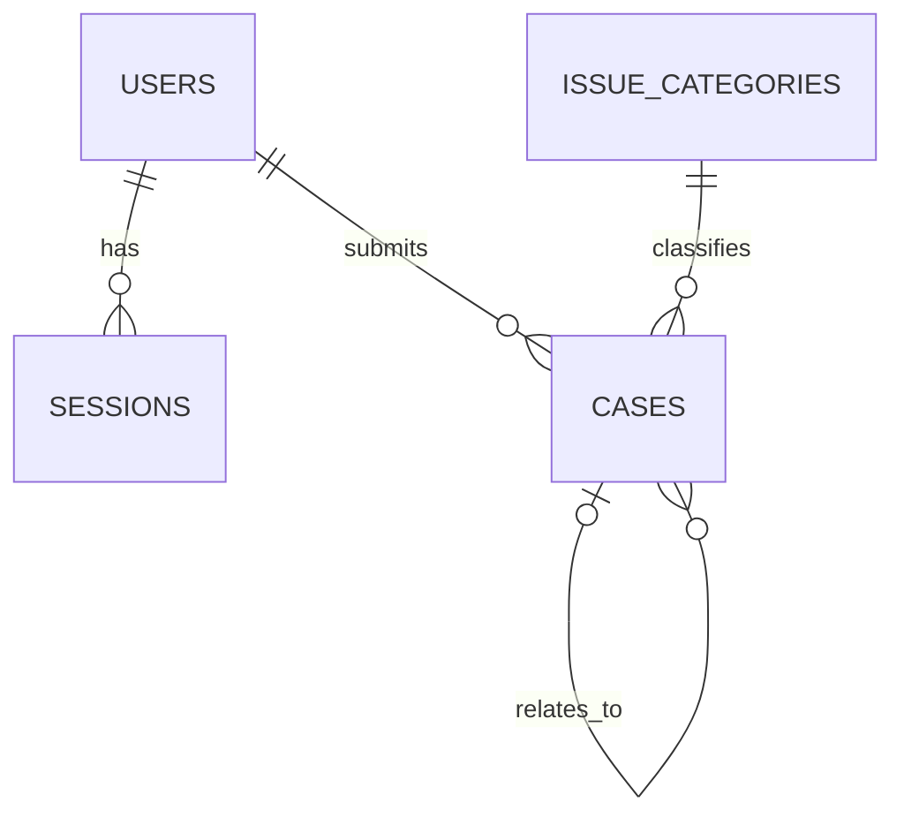

# AMNI backend

The first database milestone is implemented with PostgreSQL, SQLAlchemy, and
Alembic. It provides account/session storage, issue categories, and case records.
HTTP endpoints, login flows, assignment history, resolutions, notifications, and
frontend integration are the next milestones.

## Local setup

Requires Python 3.11+ and the PostgreSQL service from `amni/docker-compose.yml`.
The backend reads the existing `amni/.env`; no additional environment file is
needed. Keep it local and out of Git.

From the repository root:

```sh
cd amni/backend
python3 -m venv .venv
. .venv/bin/activate
python -m pip install -e '.[dev]'
```

The database connection defaults to `127.0.0.1:5433`. `POSTGRES_DB`,
`POSTGRES_USER`, and `POSTGRES_PASSWORD` come from `amni/.env`.
`POSTGRES_HOST` and `POSTGRES_PORT` can override the host and port. Passwords are
handled as secret settings and passed through SQLAlchemy's structured URL API.

## Apply migrations

With PostgreSQL running, from `amni/backend/`:

```sh
python -m alembic upgrade head
python -m alembic current
python -m alembic check
```

`upgrade head` applies pending migrations. Repeating it does not duplicate
existing tables or category records. `check` verifies that the current database
matches the model definitions.

## Inspect the schema

Open [`database/schema.sql`](database/schema.sql) for the generated SQL, or the
individual model files:

| Table | Model | Purpose |
| --- | --- | --- |
| `users` | [`user.py`](app/models/user.py) | Accounts, case-insensitive unique emails, and requester/engineer/admin roles. |
| `sessions` | [`session.py`](app/models/session.py) | Unique token digests, expiration, and revocation timestamps. |
| `issue_categories` | [`category.py`](app/models/category.py) | Selectable issue types, with unique slugs and active/inactive state. |
| `cases` | [`case.py`](app/models/case.py) | Customer, category, title, description, affected target, priority, status, related case, and timestamps. |
| `alembic_version` | Managed by Alembic | Tracks the applied migration revision. |



UUIDs identify records internally. A database-generated case number produces a
readable reference such as `AMNI-000001` after the first flush. Numbers are unique
but may have gaps, including after rolled-back transactions.

The initial migration adds Networking, Linux & Docker, Application errors,
Security, and Other. It does not create a default administrator or sample cases.

Database constraints reject unknown roles/statuses/priorities, blank required
fields, invalid foreign keys, self-related cases, malformed session digests, and
inconsistent resolution timestamps. Customer deletion is restricted when their
cases exist. Role permissions and workflow transitions still need enforcement in
the future API/service layer; table constraints are not an authentication system.

Password hashing and session token generation will be implemented with login.
The schema only stores the resulting hash/digest. `updated_at` is maintained by
ORM updates; raw SQL writers must update it explicitly.

## Test

```sh
python -m pytest
```

Database tests are opt-in. To run them with the existing local PostgreSQL server:

```sh
AMNI_RUN_DB_TESTS=1 python -m pytest
```

Integration tests create one uniquely named temporary database in the existing
PostgreSQL container, run migrations and constraint tests, then remove it. They
require a development database user with database-creation privileges and leave
AMNI's application tables untouched. No additional container is started.

## Change the schema later

1. Edit the relevant SQLAlchemy models.
2. Generate a candidate migration:

   ```sh
   python -m alembic revision --autogenerate -m "describe the schema change"
   ```

3. Review the generated script, including its handling of existing records.
4. Test it in a disposable database before applying it to application data.
5. Apply it with `python -m alembic upgrade head`.

Regenerate the SQL reference for a fresh database after migration changes:

```sh
python -m alembic upgrade head --sql > database/schema.sql
```

Migrations are the schema-change history. The SQL file is a readable generated
reference; apply changes through Alembic rather than running both mechanisms.
Downgrades can delete data and belong in disposable tests unless a deliberate
rollback has been planned.

See the [database operations guide](database/README.md) for Docker startup, `psql`,
resource limits, and persistent-volume details.
