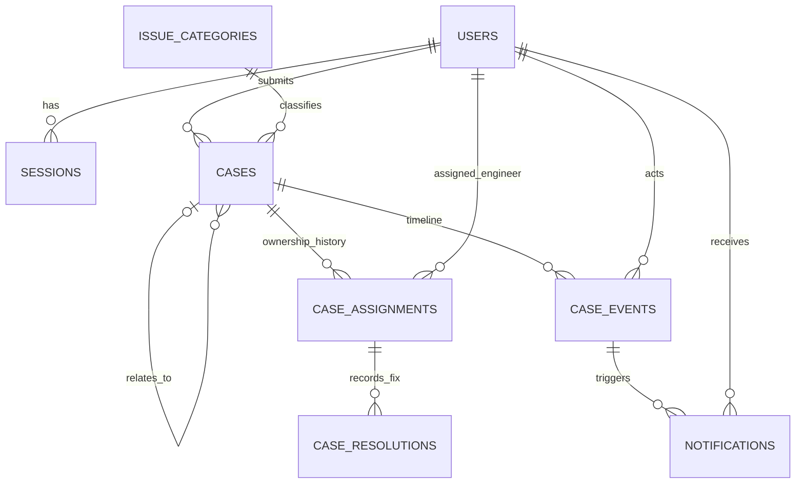

# AMNI backend

The support-case database and transactional workflow services are implemented
with PostgreSQL, SQLAlchemy, and Alembic. Customers submit issues, administrators
assign engineers, and engineers record causes and fixes. Reopening a case retains
its earlier assignments and resolutions. Notifications are stored in the database.

HTTP endpoints, login, WebSocket/email delivery, and frontend integration are
next. The frontend still uses browser demo data.

## Local setup

Requires Python 3.11+ and the PostgreSQL service from `amni/docker-compose.yml`.
The backend reads the existing `amni/.env`; no additional environment file is
needed. Keep it local and out of Git.

From the repository root:

```sh
cd amni/backend
python3 -m venv .venv
. .venv/bin/activate
python -m pip install -e '.[dev]'
```

The database connection defaults to `127.0.0.1:5433`. `POSTGRES_DB`,
`POSTGRES_USER`, and `POSTGRES_PASSWORD` come from `amni/.env`.
`POSTGRES_HOST` and `POSTGRES_PORT` can override the host and port. Passwords are
handled as secret settings and passed through SQLAlchemy's structured URL API.

## Apply migrations

With PostgreSQL running, from `amni/backend/`:

```sh
python -m alembic upgrade head
python -m alembic current
python -m alembic check
```

`upgrade head` applies pending migrations. Repeating it does not duplicate
existing tables or category records. `check` verifies that the current database
matches the model definitions.

## Inspect the schema

Open [`database/schema.sql`](database/schema.sql) for the generated SQL, or the
individual model files:

| Table | Model | Purpose |
| --- | --- | --- |
| `users` | [`user.py`](app/models/user.py) | Accounts, case-insensitive unique emails, and requester/engineer/admin roles. |
| `sessions` | [`session.py`](app/models/session.py) | Unique token digests, expiration, and revocation timestamps. |
| `issue_categories` | [`category.py`](app/models/category.py) | Selectable issue types, with unique slugs and active/inactive state. |
| `cases` | [`case.py`](app/models/case.py) | Customer, category, title, description, affected target, priority, status, related case, and timestamps. |
| `case_assignments` | [`assignment.py`](app/models/assignment.py) | Who assigned each engineer, when ownership started/ended, and assignment history. |
| `case_resolutions` | [`resolution.py`](app/models/resolution.py) | Root cause, fix, customer summary, prevention notes, and responsible assignment. |
| `case_events` | [`event.py`](app/models/event.py) | Append-only case activity with actor, timestamp, visibility, and structured details. |
| `notifications` | [`notification.py`](app/models/notification.py) | Recipient, triggering event, customer-safe message, and read timestamp. |
| `alembic_version` | Managed by Alembic | Tracks the applied migration revision. |



UUIDs identify records internally. A database-generated case number produces a
readable reference such as `AMNI-000001` after the first flush. Numbers are unique
but may have gaps, including after rolled-back transactions.

The initial migration adds Networking, Linux & Docker, Application errors,
Security, and Other. It does not create a default administrator or sample cases.

Database constraints reject unknown roles/statuses/priorities, blank required
fields, invalid foreign keys, self-related cases, malformed session digests, and
inconsistent resolution timestamps. Customer deletion is restricted when their
cases exist. A partial unique index permits only one active assignment per case. A composite
foreign key ties a resolution to the correct case and assigned engineer. A
PostgreSQL trigger rejects updates/deletes to case events. This protects normal
writes; a database administrator can still alter tables and triggers.

Workflow services enforce active accounts, roles, ownership, and status changes.
Direct SQL bypasses those service checks. HTTP authentication remains to be built.

Password hashing and session token generation will be implemented with login.
The schema only stores the resulting hash/digest. `updated_at` is maintained by
ORM updates; raw SQL writers must update it explicitly.

## Case workflow

[`app/services/cases.py`](app/services/cases.py) provides:

| Operation | Allowed actor | Stored result |
| --- | --- | --- |
| `submit_case` | Active requester | Open case, creation event, administrator notifications. |
| `assign_case` | Active administrator | Engineer assignment, retained previous assignment, engineer notification. |
| `start_case` | Current active engineer | In-progress status and timeline event. |
| `resolve_case` | Current active engineer | Cause/fix record, resolved status, ended assignment, customer notification. |
| `reopen_case` | Case owner or administrator | Open status, retained fixes, administrator notifications. |
| `search_resolutions` | Engineer or administrator | PostgreSQL full-text search over previous causes, fixes, and prevention notes. |
| `mark_notification_read` | Notification recipient | Read timestamp; repeating the operation preserves the first timestamp. |

Call each operation inside `session_scope()` or `Session.begin()`. Services flush
but do not commit; case updates, events, resolutions, and notifications commit or
roll back together. Case row locks serialize assignment and status operations.
The future API must derive actor IDs from authenticated sessions, never trust an
actor ID supplied by a client, and restrict what records each user may read.

Resolution notifications contain the customer summary. Internal root causes and
fixes remain available to staff through the resolution search service. Search is
not yet a public knowledge base or automated duplicate detection.

### Migration history

| Revision | Adds |
| --- | --- |
| `0001_accounts_categories_cases` | Accounts, sessions, categories, cases, and initial category records. |
| `0002_case_assignments` | Assignment history and one active engineer per case. |
| `0003_case_resolutions` | Retained causes/fixes and a stored, GIN-indexed search document. |
| `0004_case_events` | Case timeline and append-only trigger. |
| `0005_case_notifications` | Durable in-app notifications linked to their case event. |

Upgrading an existing installation retains its customer and case rows. Earlier
records do not acquire invented assignment history or resolutions. Alembic may
warn that a computed search column cannot be modified during comparison; changes
to its expression require a reviewed explicit migration.

## Test

```sh
python -m pytest
```

Database tests are opt-in. To run them with the existing local PostgreSQL server:

```sh
AMNI_RUN_DB_TESTS=1 python -m pytest
```

Integration tests create one uniquely named temporary database in the existing
PostgreSQL container, test migrations, constraints, role checks, and complete workflows, then remove it. They
require a development database user with database-creation privileges and leave
AMNI's application tables untouched. No additional container is started.

## Change the schema later

1. Edit the relevant SQLAlchemy models.
2. Generate a candidate migration:

   ```sh
   python -m alembic revision --autogenerate -m "describe the schema change"
   ```

3. Review the generated script, including its handling of existing records.
4. Test it in a disposable database before applying it to application data.
5. Apply it with `python -m alembic upgrade head`.

Regenerate the SQL reference for a fresh database after migration changes:

```sh
python -m alembic upgrade head --sql > database/schema.sql
```

Migrations are the schema-change history. The SQL file is a readable generated
reference; apply changes through Alembic rather than running both mechanisms.
Downgrades can delete data and belong in disposable tests unless a deliberate
rollback has been planned.

See the [database operations guide](database/README.md) for Docker startup, `psql`,
resource limits, and persistent-volume details.
